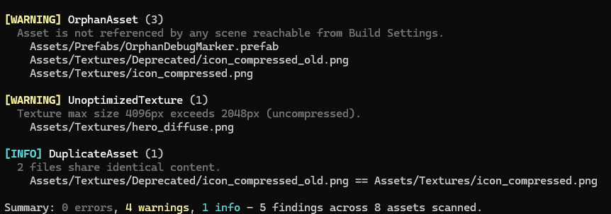

# forgekit

[](https://github.com/Goblanch/forgekit/actions/workflows/ci.yml)
[](https://www.nuget.org/packages/MiradorWorks.Forgekit)

> [Read this in English](README.en.md) *(próximamente)*

CLI de herramientas para desarrollo de videojuegos con Unity. Empieza con un auditor de assets (`forgekit assetaudit`), pensado desde el diseño para crecer con más subcomandos (el siguiente será un generador de changelogs desde Git).

## El problema

En cualquier proyecto de Unity que crece más allá de un prototipo, el árbol de `Assets/` acumula basura que nadie limpia hasta que duele:

* **Assets huérfanos:** texturas, prefabs, materiales o ScriptableObjects que ya no referencia nada en el proyecto, pero que siguen ahí, inflando el repositorio y el tamaño de la build.
* **Texturas mal configuradas:** imágenes sin comprimir o con un tamaño máximo de importación absurdamente alto para su uso real (un icono de 32px importado a 4096px por ejemplo).
* **Duplicados:** el mismo archivo importado dos veces en rutas distintas, normalmente por copia-pega entre carpetas o por fusiones de ramas mal resueltas.

Esto no es un problema técnico: cuantos más assets tiene un proyecto, más cuesta detectarlo a ojo, y casi ningún estudio pequeño tiene tiempo de mantener esta comprobación a mano. Los estudios grandes suelen automatizarlo en CI, en el resto, simplemente no se hace.

`forgekit assetaudit` resuelve esto: analiza el proyecto sin necesidad de abrir el Editor de Unity y genera un reporte de hallazgos.

---

## Instalación

Requiere el [SDK de .NET 10](https://dotnet.microsoft.com/download).

```bash
dotnet tool install --global MiradorWorks.Forgekit --prerelease
```

Para actualizar: `dotnet tool update --global MiradorWorks.Forgekit --prerelease`.

## Uso

```bash
forgekit assetaudit --project <ruta-al-proyecto-unity>
```



### Opciones

| Opción | Descripción | Por defecto |
| --- | --- | --- |
| `--project` | Raíz del proyecto Unity (contiene `Assets/` y `ProjectSettings/`). Obligatoria | — |
| `--output` | Fichero donde escribir el informe. Acepta: `json` `markdown` `md` | stdout |
| `--format` | `console`, `json` o `markdown` | `console` |
| `--max-texture-size` | Tamaño máximo de importación aceptado sin aviso | `2048` |
| `--exclude` | Fragmento de ruta a excluir. Se puede repetir | `/Resources/`, `/Addressables/` |
| `--severity-threshold` | Muestra solo hallazgos de esta severidad o superior | `info` |
| `--fail-on` | Devuelve código 1 si hay hallazgos de esta severidad o superior. Acepta: `warning` `error` | — |

### Códigos de salida

| Código | Significado |
| --- | --- |
| `0` | Sin hallazgos que alcancen `--fail-on` |
| `1` | Hay hallazgos con severidad ≥ `--fail-on` |
| `2` | Error de uso (argumentos o proyecto inválidos) |
| `3` | Error en tiempo de ejecución |

`--fail-on` se evalúa sobre el informe completo; `--severity-threshold` solo filtra lo que se muestra.

### Uso en CI (proyecto Unity)

```yaml
- uses: actions/setup-dotnet@v4
  with:
    dotnet-version: 10.0.x
- run: dotnet tool install --global MiradorWorks.Forgekit --prerelease
- run: forgekit assetaudit --project . --fail-on error
```

Si hay hallazgos de severidad `error` o superior, el job falla.

## Limitaciones conocidas

* Los assets cargados por string en runtime (`Resources.Load`) o vía Addressables no aparecen en el grafo de referencias serializadas. Por eso `Resources/` y `Addressables` se excluyen por defecto del chequeo de huérfanos. Detectarlos exigiría analizar código C#.
* `--exclude` compara fragmentos de ruta, no patrones glob.
* No detecta `.meta` huérfanos (sin asset asociado) ni assets sin `.meta`, típicos de merge mal resueltos.
* Solo soporta Unity; los `.uasset` de Unreal no porque son binarios propietarios.

## Qué es lo que hay que resolver (y cómo)

### 1. Inventario de assets

Recorrer `Assets/` y listar todos los archivos gestionados por Unity (excluyendo los `.meta`, que son metadatos, no assets en sí).

### 2. Grafo de referencias

Los archivos de escena (`.unity`), prefab y asset serializado (`.asset`) de Unity son **YAML en texto plano**, no binarios. Cada referencia a otro asset aparece como una línea con un `guid: <hash>`. Parseando estos archivos, se puede construir un grafo de "qué asset referencia a qué otro", sin depender del Editor de Unity ni de sus APIs internas.

### 3. Detección de assets huérfanos

Un asset cuyo GUID no aparece como referencia en ningún otro archivo del proyecto, y que tampoco está listado en las escenas de Build Settings, es candidato a huérfano.

**Limitación conocida y deliverada:** los assets cargados dinámicamente por string (`Resources.Load("ruta")`) o vía Addressables no aparecen en el grafo de referencias serializadas, porque se resuelven en tiempo de ejecución, no por referencia GUID. La v1 de la herramienta excluye el chequeo de cualquier asset bajo convenciones de carpeta conocidas (`Resources/` y `Addressables/`) en vez de arriesgarse a falsos positivos.

### 4. Auditoría de configuración de importación

Cada asset tiene un `.meta` asociado. Para texturas, ese `.meta` contiene la configuración de importación (compresión, tamaño máximo). Parseando esos campos se puede flagear cualquier textura que exceda un umbral configurable (por ejemplo, tamaño máximo superior a 2048px sin compresión activada).

### 5. Detección de duplicados

Hash de contenido (no de nombre de archivo) sobre cada asset para detectar el msimo archivo importado en más de una ruta.

### 6. Reporte

Salida en tabla por consola, con exportación opcional a JSON o Markdown, y un nivel de severidad (Info / Warning / Error) por cada hallazgo.

---

## Otros casos límite a tener en cuenta durante el diseño

* **Prefab variants:** un prefab variant referencia a su prefab base, no debe marcarse como huérfano aunque nada más lo referencie directamente.
* **ScriptableObjects asignados solo desde el Inspector:** si la escena o el prefab que los referencia está bien parseado, el grafo ya los cubre. Si el parseo falla o el asset se asigna de otra forma no cubierta, aparecerá como falso huérfano.

---

## Estado del proyecto

(pendiente - se documentará cuando exista una primera build funcional)

---

## Roadmap

* [x] Parser de YAML de Unity y grafo de referencias por GUID
* [x] Detección de huérfanos, texturas sin optimizar y duplicados
* [x] Informe en consola, JSON y Markdown
* [x] Empaquetado como `dotnet tool` y CI con GitHub Actions
* [ ] Publicación en NuGet (`0.1.0`)
* [ ] Chequeo de `.meta` huérfanos y assets sin `.meta`
* [ ] Exclusiones con patrones glob
* [ ] `--verbose`
* [ ] Segundo subcomando: `forgekit changelog`

---

## Licencia

MIT. Ver [LICENSE](LICENSE).
